# VP_AR_full_System — Offline Pipeline

This repository holds the **offline analysis and calibration pipeline** of a base-free virtual production and augmented reality (VP/AR) system. The system films a performer with a **Sony ZV-E10 II** (the production camera) and uses a **ZED 2i** stereo camera mounted on the same rig as camera tracker, motion-capture sensor and depth sensor. A **Jetson AGX Orin** on the rig runs the ZED; **Unreal Engine 5** on a workstation composites CG elements into the Sony image in real time, so that real objects and people can hide CG objects (occlusion) and CG can react to the performer's movement.

The real-time side lives in [`VP_AR_full_System_runtime`](https://github.com/Muhannad7794/VP_AR_full_System_runtime). This repository produces the numbers that the real-time system depends on, and the evidence that those numbers are correct:

| Service | Question it answers | Main result |
|---|---|---|
| **Extraction** | What did each camera record, and when? | Frames, depth, confidence, per-frame timestamps |
| **Temporal alignment** | Which ZED frame was taken at the same moment as each Sony frame? | Frame mapping and synchronised dataset |
| **Spatial alignment** | Where is the Sony camera relative to the ZED, and what are its lens properties? | Calibration values for Unreal Engine, with validation |
| **Kinematics** | How noisy is the ZED skeleton, and how well does the 1 Euro filter clean it? | Filtered joint trajectories, movement metrics |
| **Occlusion refinement** | Which ZED depth pixels are unreliable, and where? | Confidence-gating statistics and maps |

Every service runs inside the same GPU Docker image and writes its plots to `data/plots/<dataset>/`. The figures in this README are examples of those plots, with an explanation of how to read each one.

---

## Contents

- [Getting Started](#-getting-started)
- [Recording a Dataset](#-recording-a-dataset)
- [Phase 1: Frame Extraction](#-phase-1-frame-extraction)
- [Phase 2: Temporal Alignment](#%EF%B8%8F-phase-2-temporal-alignment)
- [Phase 3: Spatial Alignment](#-phase-3-spatial-alignment)
- [Phase 4: Kinematic Extraction and Filtering](#-phase-4-kinematic-extraction-and-filtering)
- [Phase 5: Embodied Interaction — Kinematic AR](#-phase-5-embodied-interaction--kinematic-ar)
- [Phase 6: Occlusion Refinement](#-phase-6-occlusion-refinement)
- [Related Repositories](#-related-repositories)
- [Output Reference](#output-reference)
- [Directory Structure](#directory-structure)

---

## 🚀 Getting Started

### Requirements

- An NVIDIA GPU with a driver that supports **CUDA 12.8 or newer**: the "CUDA Version" shown by `nvidia-smi` must be 12.8 or higher.
- Docker with GPU support: Docker Desktop with the WSL 2 backend on Windows, or Docker Engine with the NVIDIA Container Toolkit on Linux.
- Internet access during the build: the ZED Python API is downloaded from Stereolabs.

### Build the image

All services share one image, `vp_ar_full_system:zed5.2`, based on `stereolabs/zed:5.2.3-devel-cuda12.8-ubuntu22.04`. The ZED SDK version matches the Jetson that records the SVO files, because an SVO written by a newer SDK may not open with an older one. The image is built once, by the `extract` service:

```bash
docker compose build extract
```

### Run a service

| Service | Runs | Mounted into the container |
|---|---|---|
| `extract` | `run_extract.sh` | `extract_frames.py`, `run_extract.sh`, `data/` |
| `sync` | `run_temporal.sh`, `check_svo.py` | `temporal_alignment/`, `run_temporal.sh`, `data/` |
| `align` | `run_spatial.sh` | `spatial_alignment/`, `run_spatial.sh`, `data/` |
| `filter` | `run_filtering.sh` | `skeleton_filtering/`, `run_filtering.sh`, `data/` |
| `occlusion` | `run_occlusion.sh` | `occlusion_refinement/`, `run_occlusion.sh`, `data/` |

```bash
docker compose run --rm <service> ./<runner>.sh <dataset name>
```

The code folders are mounted, not copied, so changes to a script take effect without rebuilding the image. A persistent volume (`zed_resources`) keeps the optimised ZED depth model between runs, so it is not re-optimised in every new container.

> Run the pipeline inside the containers, not in a local Python environment: OpenCV, NumPy 2 and the ZED Python API are only installed in the image.

---

## 🎥 Recording a Dataset

A dataset is one recording session: a ZED **SVO2** file recorded on the Jetson and a Sony **MP4** recorded through the capture card (OBS, constant frame rate). Put both in `data/raw/<dataset name>/`. If the session was recorded with the Jetson recorder (`record_zed_svo.py`), copy its logs (`<name>_timestamps.csv`, `_events.csv`, `_board.csv`, `_settings.json`) into the same folder; the extraction checks the SVO against them.

The recording protocol is what makes the offline pipeline reliable:

1. **Cover both lenses at the start and at the end** with an opaque card for 1 to 2 seconds. The dark periods are visible in both cameras and mark the moment the recording becomes usable (Phase 2).
2. **For calibration datasets, hold the ChArUco board still for 1 to 2 seconds in each pose.** Moving boards are blurred and are rejected. Cover the whole Sony frame (centre, edges, corners), at several distances (about 0.6 m to 1.5 m) and tilts (up to about 30°).
3. **Use manual exposure on the ZED** (short exposure time, less motion blur). The recorder sets exposure, gain and white balance explicitly and shows the live board detection and an outline of the Sony frame in a browser preview.
4. **Measure the printed board.** Printers scale pages slightly. The square length sets the metric scale of the whole calibration (Phase 3.2).

---

## 🧩 Phase 1: Frame Extraction

```bash
docker compose run --rm extract ./run_extract.sh <dataset name>
```

**What this does**

- Decodes the SVO with the ZED SDK and saves, per frame, the **rectified left image**, the **depth map** (16-bit millimetres, 0 = no depth) and the **confidence map** (1 = most reliable, 100 = least reliable).
- Decodes the MP4 and saves every Sony frame.
- Records the **timing** of every frame: the ZED camera timestamp from the SVO and the Sony container time. Gaps in the ZED timestamps reveal frames the camera dropped during recording.
- Computes two cheap signals for every frame on a 160 × 90 grey version of the image: **luma** (average brightness) and **motion** (average change from the previous frame). Phase 2 aligns the two cameras with these signals.
- Saves the **rectified ZED intrinsics** of the session, the exact lens model of the saved ZED frames and depth maps.
- When the recorder logs are present, compares the number of frames and the timestamps of the SVO with the log.

Options: `--skip N` saves every N-th frame (signals are still computed for every frame), `--disable-self-calib` turns off the ZED's automatic recalibration while decoding.

**Checking an SVO file before extraction**

```bash
docker compose run --rm sync python3 temporal_alignment/check_svo.py --dataset <dataset name> [--full]
```

Checks that the SVO opens with the installed SDK, that it holds as many frames as the recorder logged, and that frame *k* carries the timestamp of log row *k*. `--full` decodes every frame.

---

## ⏱️ Phase 2: Temporal Alignment

```bash
docker compose run --rm sync ./run_temporal.sh <dataset name> [sync_frames.py options]
```

### The problem

The two cameras record on separate machines with separate clocks, and they do not start at the same moment. The ZED records at about 29.86 frames per second and occasionally drops a frame; the Sony recording has an exact, constant 30 frames per second. To compare a Sony frame with ZED data (depth, board corners, skeleton), the pipeline must know which ZED frame was taken **at the same instant**.

### The method

Each camera has its own time axis: the ZED timestamps from the SVO, and frame number ÷ 30 for the Sony. Both clocks run in real time, so the two axes differ by a constant **offset** *b*:

```
t_zed = t_sony + b
```

The offset is measured in two independent ways, and the two results must agree:

1. **Cover events.** The card over the lenses makes both images dark. The edges of the dark periods are timed in both recordings and compared.
2. **Motion correlation.** The motion signal of both cameras (how much the image changes from frame to frame) is compared at every possible offset. The offset at which the two signals match best is the time difference. This uses thousands of frames and is the more precise estimate.

The pipeline then checks whether the offset **drifts** over the recording (one clock running slightly faster than the other) by measuring it again in 40-second windows. Drift is corrected only when it is significant. Finally, every Sony frame is paired with the ZED frame closest in time. Pairs further apart than 0.6 of a frame (a ZED frame was dropped) and frames inside the dark periods are excluded. Only the **active window** between the two cover events goes into the synchronised dataset.

| Step | Script | Output |
|---|---|---|
| 1/4 | `sync_frames.py` | `frame_mapping.json`, `frame_mapping_full.json`, `frame_mapping_detail.csv`, `sync_report.json`, plots in `data/plots/<dataset>/sync/` |
| 2/4 | `smooth_frames_mapping.py` | `smoothed_frame_mapping.json`, `drift_comparison.jpg` |
| 3/4 | `compare_mappings.py` | `data/txt_output/<dataset>/mapping_comparison.txt` |
| 4/4 | `compile_dataset.py` | `data/synced/<dataset>/` and `synced_index.csv` |

Useful options of `sync_frames.py`: `--window START END` sets the active window by hand (Sony seconds), `--offset-source events|motion` or `--offset S` forces the offset, `--max-dt-ms` changes the pairing limit, `--method dtw` runs the earlier image-similarity method (ResNet18 features with FastDTW) for comparison.

### Result — dataset_05

| Quantity | Value |
|---|---|
| Sony | 8,919 frames, 297.3 s, 30.00 fps (1 repeated frame) |
| ZED | 8,938 frames, 302.1 s, 29.86 fps, 93 frames dropped in 24 gaps |
| Offset *b* | −1682.8 ms (motion correlation, r = 0.987) |
| Drift | 56 ± 21 ppm, 13.5 ms over the recording: below the significance limit, not applied |
| Active window | Sony 19.90 s to 283.34 s |
| Mapped pairs | 7,817 (86 Sony frames without a ZED frame within 20 ms, caused by dropped ZED frames) |
| Pairing residual | median 8.5 ms, maximum 19.5 ms |

### Plots

**Luma and cover events** — `sync/sync_luma.png`

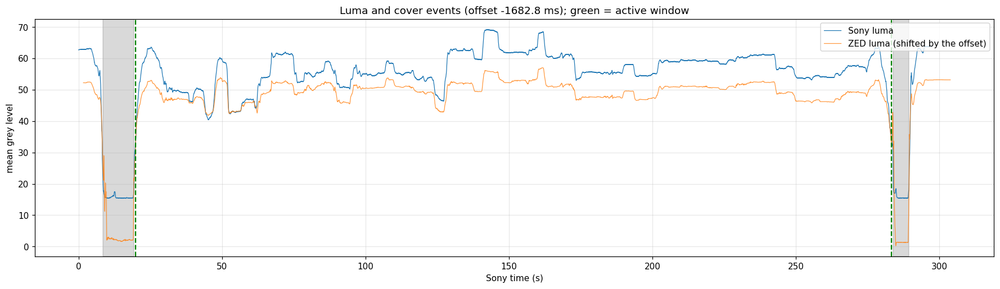

> The average brightness of every frame over time, for the Sony and for the ZED (the ZED curve shifted by the measured offset). The grey bands are the dark periods where the lenses were covered; the green dashed lines mark the active window. When the offset is correct, the two curves rise and fall together over the whole recording, so this plot is the first visual check of the synchronisation.

**Motion correlation** — `sync/sync_correlation.png`

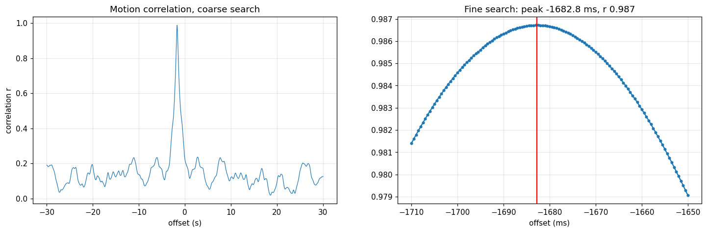

> How well the two motion signals match (correlation *r*, 1 = identical) for every candidate offset. Left: a coarse search over ±30 s finds one clear peak. Right: a fine search around that peak in 0.5 ms steps; the red line is the measured offset. A single high, narrow peak (here r = 0.987, the next-best candidate only 0.62) means the offset is unambiguous.

**Drift check** — `sync/sync_drift.png`

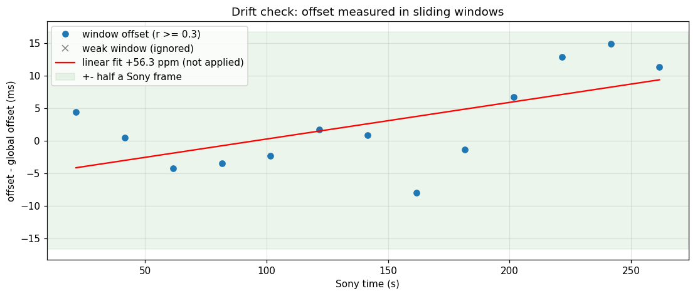

> The offset measured separately in 40-second windows along the recording, relative to the global offset. If one clock ran faster, the points would form a slope. The green band is ±half a Sony frame: as long as the points stay inside it, a single constant offset pairs every frame correctly. The red line is the fitted drift; its label says whether it was applied.

**Pairing residuals** — `sync/sync_residuals.png`

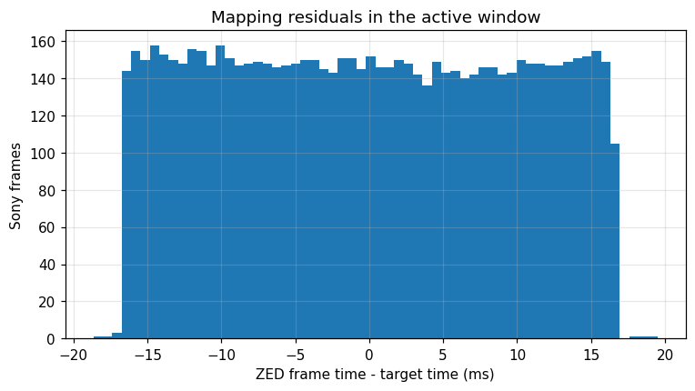

> For every mapped Sony frame, the time difference between the moment it was taken and the ZED frame it was paired with. The ZED records slightly slower than 30 fps, so the difference sweeps evenly between 0 and about half a frame (±17 ms), and no pair exceeds the 20 ms limit.

**Frame offset over the recording** — `drift_comparison.jpg`

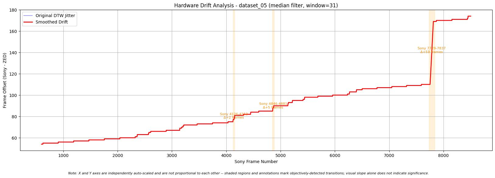

> The difference between the Sony frame number and the paired ZED frame number. It grows steadily because the ZED records slightly fewer frames per second, and it jumps where the ZED dropped frames. The red curve is the median-filtered mapping that is compiled into `data/synced/`. With the time-based method the mapping only ever increases, and a median filter leaves such a sequence unchanged, so the two curves coincide. The filter matters only for the legacy DTW method, whose mapping jitters.

### 2.1 Known limits and the valid frame window

- The time-based method needs **one shared event visible to both cameras** (the cover events) or enough scene motion for the correlation. A recording of a static scene without cover events cannot be aligned.
- Only the **active window** between the first and last cover event is compiled. The mapping of the whole overlap is kept in `frame_mapping_full.json`. Without cover events, `--allow-full-overlap` uses the whole overlap as the window, or `--window START END` sets it by hand.
- **Dropped ZED frames are excluded, not interpolated.** The 86 Sony frames without a ZED partner in dataset_05 are missing from `data/synced/`.
- The Sony time axis assumes the MP4 has a **constant frame rate**. Check with `ffprobe` when another recorder is used.

---

## 📐 Phase 3: Spatial Alignment

```bash
docker compose run --rm align ./run_spatial.sh <dataset name> [zed_intrinsics.json] [--sony-model NAME] [--from-step N] [--square-mm MM]
```

### The problem

The ZED measures depth from its own position, but the CG is shown in the Sony image. To use a ZED depth value in the Sony image, the system must know:

- the **intrinsics** of each camera: focal length *f* (how strongly the lens magnifies, in pixels) and principal point *(cx, cy)* (the pixel where the optical axis meets the image);
- the **extrinsics**: the rotation *R* and translation *T* that move a point from the ZED's coordinate frame into the Sony's (`X_sony = R · X_zed + T`).

These are measured with a **ChArUco board**: a checkerboard with coded markers, so that every corner can be identified even when part of the board is hidden. Because the size of the board is known, every view gives a set of corners whose 3D positions are known and whose 2D positions are detected in the image.

### 3.1 How the pipeline is built

The pipeline is designed so that errors cannot hide inside each other:

- **The ZED intrinsics are not estimated.** The ZED SDK rectifies every image onto a virtual distortion-free camera and computes depth on the same grid, so its intrinsics are read from the SDK and used as they are.
- **The Sony intrinsics are estimated from Sony frames alone,** where the board can also be close to the camera or at the edges of the frame that the ZED does not share.
- **The extrinsics are solved with both cameras' intrinsics fixed.** Six unknowns remain, so an error in a focal length cannot be absorbed into the rotation and translation.
- **Every result is tested on views it was not fitted on** (held-out views), and against the ZED's own depth measurement.

A **hold** is a run of consecutive frames in which the board is still (the board corners move less than 1.5 Sony pixels between frames). Each hold contributes at most one view, so a long pause in one pose does not count many times. Views are ordered by **diversity** (position in the frame, distance, tilt), and every fourth view is held back for testing, so that both sets span the whole recording.

| Step | Script | What it does |
|---|---|---|
| 0 | `print_zed_intrinsics.py` | Reads the rectified ZED intrinsics from the SDK |
| 1 | `inspect_detections.py` | Detects the board in every synced frame and marks usable and still frames |
| 2 | `calibrate_sony_intrinsics.py` | Fits the Sony lens, compares distortion models on held-out views |
| 3 | `pick_frames.py` | Selects diverse stereo pairs, splits them into calibration and held-out sets |
| 4 | `stereo_calibrate.py` | Solves *R* and *T*, with outlier rejection and a bootstrap uncertainty |
| 5 | `validate_calibration.py` | Tests the calibration on held-out pairs and through the ZED depth |
| 6 | `apply_calibration.py` | Prints the values for Unreal Engine |

**Options**

| Option | Effect |
|---|---|
| `zed_intrinsics.json` (2nd argument) | Use intrinsics written on the Jetson with `print_zed_intrinsics.py --live --out zed_live.json`, so the calibration uses exactly the live camera's values |
| `--sony-model NAME` | Fix the Sony lens model (`pinhole`, `k1`, `k1_k2`, `k1_k2_tangential`, `k1_k2_k3_tangential`) instead of selecting it on held-out error. Use `pinhole` for a camera that corrects its lens distortion internally |
| `--from-step N` | Start at step N and reuse earlier outputs |
| `--square-mm MM` | Measured board square length in millimetres (overrides the value in `calib_common.py`) |

### 3.2 The board

| Property | Value |
|---|---|
| Layout | 11 × 8 squares (10 × 7 inner corners, 70 in total), legacy pattern |
| Markers | ArUco `DICT_4X4_50`, marker length = 0.75 × square length |
| Square length | **28.36 mm measured** (design value 28 mm; the print is 1.3 % larger) |

Every distance the calibration reports inherits the square length. Measure the printed board across all 11 squares of one row with a steel ruler, divide by 11, and set the result with `--square-mm` or `MEASURED_SQUARE_MM` in `spatial_alignment/calib_common.py`. Changing it requires re-running from step 2. The validation reports a **scale check** that detects a wrong square length (3.5).

### 3.3 Step 1 — Board detection

Detects the board in every synced Sony and ZED frame. A view is **usable** when it has at least 15 corners and those corners span at least 25 % of the board area; a usable view is **still** when the board barely moved. Outputs: `detections.json.gz`, `detection_summary.json`.

**Detection over the recording** — `spatial/detection_timeline.png`

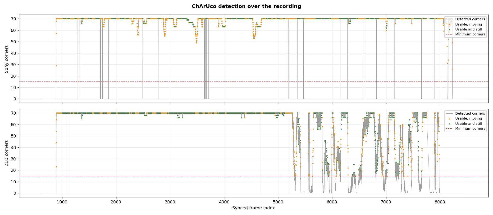

> The number of board corners found in every frame (top: Sony, bottom: ZED), out of 70. Orange dots are usable frames in which the board moves; green dots are usable and still, the candidates for calibration. The red dashed line is the 15-corner minimum. In dataset_05 the Sony sees almost all corners throughout. The ZED loses corners in the second half, where the board is about 1.3 m away: the ZED's wider lens makes the board smaller in its image. The pipeline copes because it needs only a minimum number of well-spread corners, not the whole board.

### 3.4 Step 2 — Sony intrinsics

Fits five lens models, from a pure **pinhole** (no distortion) to five distortion coefficients, on 40 Sony views, and scores each on the held-out views. For dataset_05 the Sony model is fixed to `pinhole` (`--sony-model pinhole`). The camera corrects its lens distortion internally, and the models with distortion found a 14 % longer focal length (1537 to 1551 px instead of 1358 px): a known trade-off between focal length and distortion when the board covers only part of the frame. The pinhole focal length agrees with the optics (16 mm lens) and gives a ZED–Sony translation that matches a tape measurement.

**Model comparison** — `spatial/sony_intrinsics_models.png`

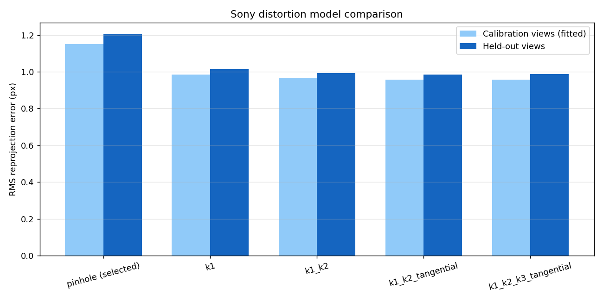

> The reprojection error of each lens model: how far, on average, the detected corners lie from where the fitted model predicts them. Light bars are the views used for fitting; dark bars are held-out views. A model that fits its own views much better than new views is overfitting. Here every model generalises (light and dark bars are close). The distortion models are about 0.2 px better than the pinhole, but at the cost of the unrealistic focal length described above.

**Corner coverage** — `spatial/sony_intrinsics_coverage.png`

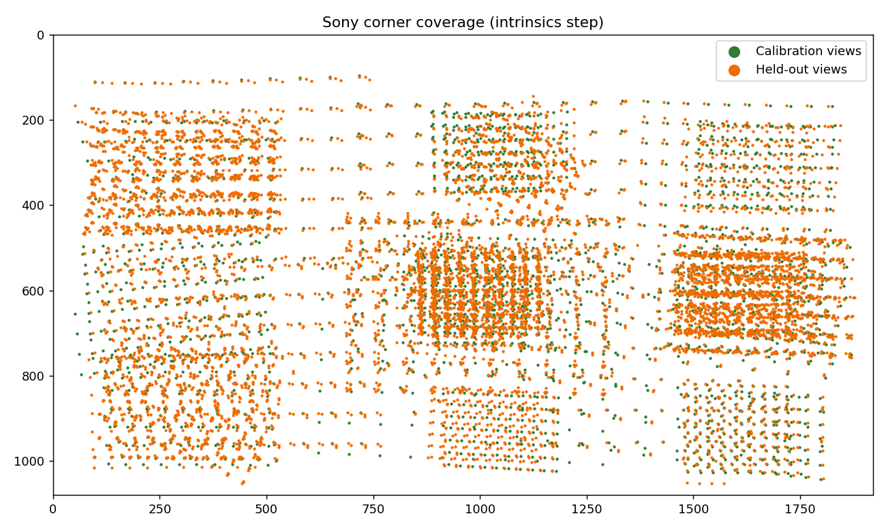

> Every board corner used in this step, drawn at its position in the Sony image (green: calibration views, orange: held-out views). A lens model is only trustworthy where it has seen corners. Corners reaching the edges and corners of the frame are what constrain distortion and focal length.

**Distortion left out at runtime** — `spatial/sony_runtime_displacement.png`

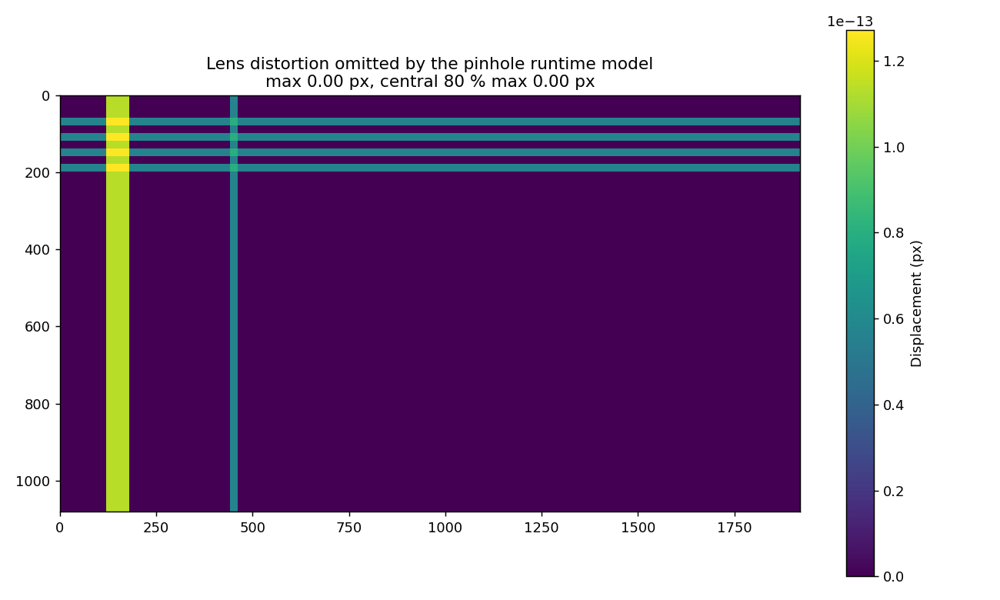

> Unreal Engine's camera and the depth reprojection shader are pinhole cameras. This map shows, for every pixel, how far the selected lens model would place a point compared with that pinhole camera, which is the error the runtime accepts. With a distortion model it is zero at the centre and grows towards the corners. For dataset_05 the selected model *is* the pinhole, so the map is zero everywhere: the colour scale shows only floating-point rounding (10⁻¹³ px).

### 3.5 Step 3 — Stereo pair selection

Pairs frames in which **both** cameras see the board and the board is still, groups them into holds, and orders them by diversity. Dataset_05: 1,591 still pairs, 140 distinct poses, 40 for calibration and 100 held out, at 0.59 to 1.47 m and up to 31° tilt. The selected frames are copied to `data/picked_for_alignment/` and `data/picked_for_validation/`. Output: `pair_selection.json`.

**Selected stereo pairs** — `spatial/pair_selection_features.png`

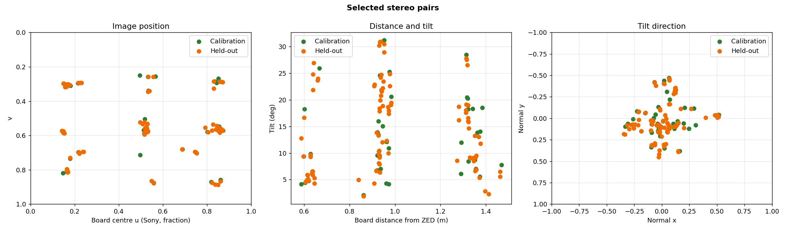

> Each dot is one selected board pose (green: calibration, orange: held-out). Left: where the board centre was in the Sony image. Middle: distance from the ZED against tilt. Right: the direction in which the board faced. A good set spreads in all three panels. Distance matters most: errors in rotation and translation can only be told apart when the board was seen at several distances.

### 3.6 Step 4 — Extrinsics

Solves *R* and *T* with OpenCV's stereo calibration, with both cameras' intrinsics fixed. Pairs with an error far above the rest are removed once and the solve is repeated. A **bootstrap** (re-solving 200 times on random resamples of the pairs) gives the uncertainty. Output: `spatial_calibration.json`.

| Quantity | dataset_05 |
|---|---|
| Stereo fit RMS | 1.189 px over 40 pairs |
| Translation ZED → Sony | −7.50, −10.61, −5.58 cm (tape: −7.4, −10.5, −5.0 cm) |
| Rotation | −2.41°, +0.78°, +0.24° (rotation vector) |
| Bootstrap uncertainty | 0.3 / 0.3 / 0.2 mm, 0.025° |

### 3.7 Step 5 — Validation

The validation asks how well the calibration **predicts** new data, from the easiest test to the one the live system faces:

| Measurement | Meaning | dataset_05 (calibration · held-out) |
|---|---|---|
| Sony alone (step 2) | Lens model fitted to Sony views; nothing from the ZED involved | 1.208 px held-out |
| Stereo fit (step 4) | How well the solved geometry fits the views it was solved on | 1.189 px |
| Sony floor | Best any calibration could reach on these corners: the board pose fitted to the Sony corners alone | 1.24 · 1.29 px |
| Corner transfer | Board pose seen by the ZED, moved with *R* and *T*, drawn into the Sony image, compared with the Sony's detections | 1.87 · 2.00 px |
| Excess over the floor | √(transfer² − floor²): the part added by the ZED-to-Sony chain | 1.40 · 1.53 px |
| **End-to-end** | ZED depth at each corner, moved with *R* and *T*, drawn into the Sony image: the path the live system uses | **1.61 · 1.53 px** |

All errors are in Sony pixels (1 px ≈ 0.7 mm at 1 m). Two **checks** accompany the numbers:

- **Scale check:** the ratio between the ZED's measured depth and the board distance computed from the board's size. **1.0009** for dataset_05: the depth and the board agree within 0.1 %. With the design square length (28 mm) this ratio was 1.013, which revealed that the printed board was 1.3 % larger than designed.
- **Runtime bias check:** the largest average offset of the end-to-end error in any distance band, the systematic shift visible along occlusion edges. **0.61 px** for dataset_05 (limit 1 px).

The calibration is **graded on the excess over the floor**, because only that part can be improved by a better calibration: below 0.5 px Excellent, 1 px Good, 2 px Acceptable, otherwise Poor. Dataset_05 is graded **Acceptable**. The end-to-end error (1.53 px) is lower than the corner transfer error, which indicates that the board pose seen by the ZED (computed assuming a perfectly flat board) limits the corner-transfer test, rather than the calibration itself.

**Reprojection error analysis** — `spatial/reprojection_error_analysis.png`

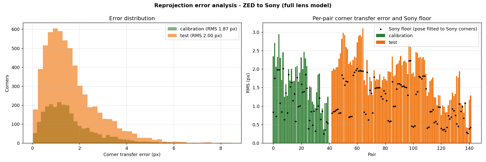

> Left: how far each predicted corner landed from the detected corner, for all corners (green: calibration pairs, orange: held-out pairs). Right: the error of each pair as a bar, with a black dot for that pair's Sony floor. Where a bar is much taller than its dot, the ZED-to-Sony chain added error; where they are close, the error is already present in the Sony image itself (detection noise, lens model).

**Error against distance** — `spatial/error_vs_distance.png`

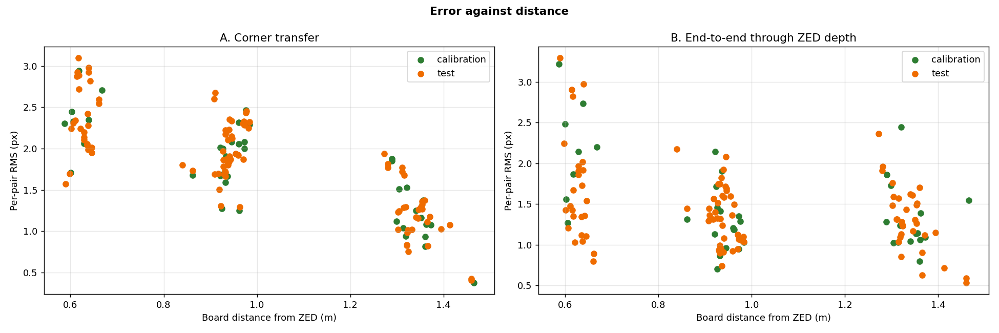

> The error of each pair against how far the board was from the ZED. A: corner transfer; B: end-to-end through the ZED depth. A calibration error caused by a wrong translation grows towards the camera; a rotation error does not depend on distance. The error is largest at 0.6 m, where the board fills much of the frame and reaches the Sony's frame edges, and about 1 to 1.5 px at 1.3 m.

**Signed bias against inverse distance** — `spatial/bias_vs_inverse_distance.png`

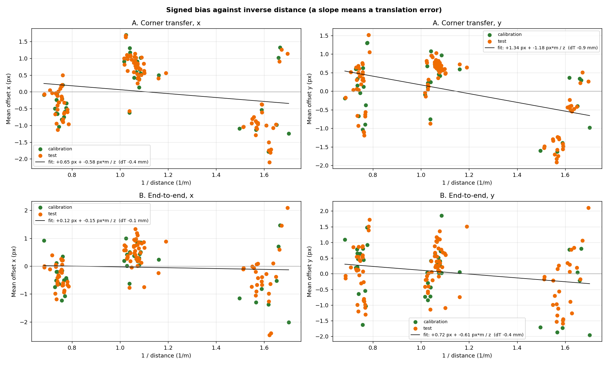

> The average *direction* of the error of each pair (x: horizontal, y: vertical) against 1/distance. Random errors average out; a consistent shift points to a cause. A translation error shifts the image in proportion to 1/distance, so it appears as a **slope**; a rotation or principal-point error appears as a constant offset. The fitted line converts the slope into the implied translation error ("dT"). For dataset_05 the end-to-end slopes correspond to 0.1 to 0.4 mm, so the translation is effectively exact.

**Depth scale check** — `spatial/depth_scale_check.png`

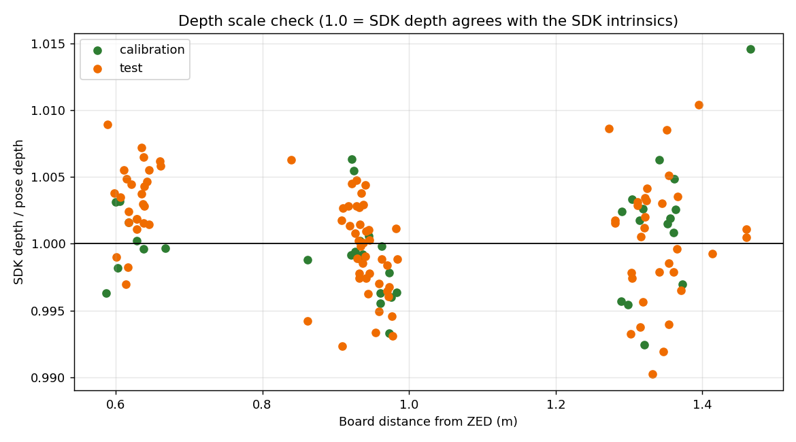

> For each pair, the ZED's measured depth divided by the distance computed from the board's known size. 1.0 means the two agree. The points scatter within ±1 % around 1.0 at every distance, so the ZED depth and the calibration share the same scale. A ratio consistently away from 1.0 means either the board square length or the ZED depth scale is wrong; the validation then prints the square length that would make the two agree.

**Error across the Sony frame** — `spatial/error_across_sony_frame.png`

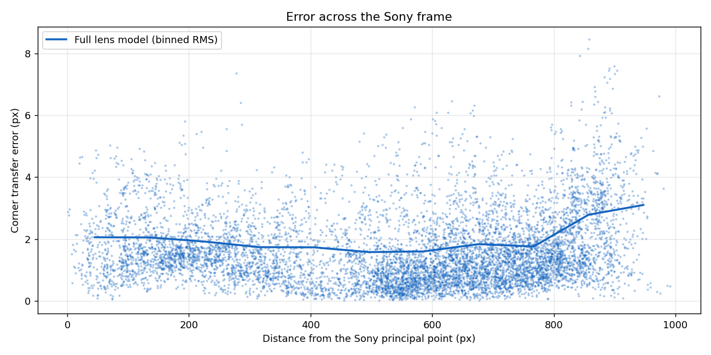

> The error of every corner against its distance from the Sony's principal point (0 = image centre, about 1100 px = frame corner). The line is the average per band. The error stays near 1.7 px up to about 800 px from the centre and rises to about 3 px beyond, towards the frame corners. That rise is the lens distortion that the pinhole model leaves out, a known limit of the runtime camera model.

**Corner coverage** — `spatial/corner_coverage_sony_rgb.png`, `spatial/corner_coverage_zed_rgb.png`

| Sony | ZED |
|:---:|:---:|
| 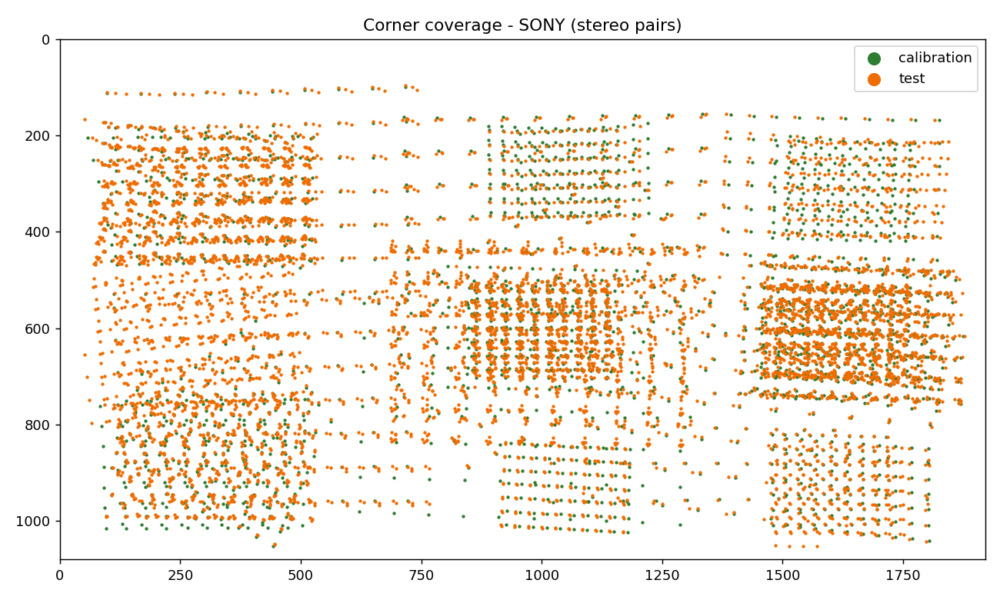 | 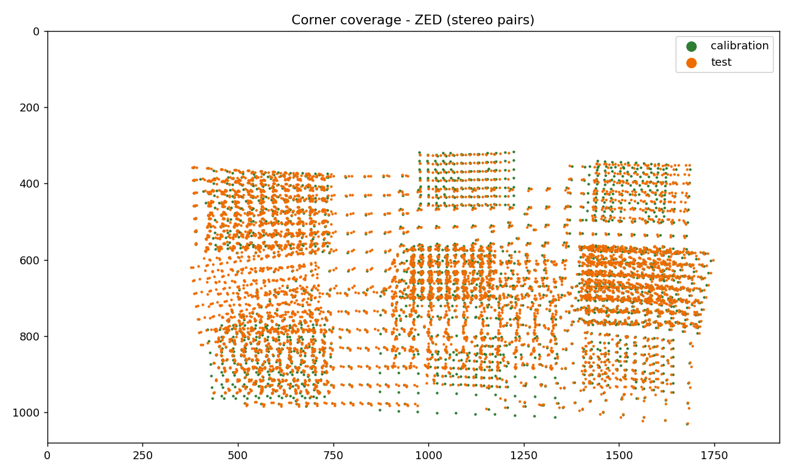 |

> Every corner of the selected stereo pairs, drawn at its position in each camera. The Sony coverage reaches the frame edges; the ZED coverage occupies the centre of the ZED image, because the ZED's wider lens sees the same board smaller and closer to its centre. This is expected: the calibration needs corners spread across the *Sony* frame, which is where the result is used.

### 3.8 Step 6 — Values for Unreal Engine

`apply_calibration.py --ue5` prints every value the real-time system needs. The Unreal Engine values derived from the calibration (dataset_05, W × H = 1920 × 1080):

| Where in Unreal Engine | Value | How it is derived |
|---|---|---|
| Depth reprojection material: `Sony_FX/FY/CX/CY`, `ZED_FX/FY/CX/CY`, `R_Row0–2`, `T_Metres` | printed by step 6 | Directly from `spatial_calibration.json` (OpenCV camera frames, metres, pixels) |
| `BP_TrackerAnchor` lens offset, location | X +6.12, Y +7.46, Z −10.33 cm | Sony optical centre in the ZED's Unreal axes (X forward, Y right, Z up) |
| `BP_TrackerAnchor` lens offset, rotation | X (Roll) −0.254°, Y (Pitch) +2.404°, Z (Yaw) −0.780° | Sony orientation in the same axes |
| CineCamera focal length | 16.475 mm (sensor width 23.3 mm, height 13.106 mm) | f_mm = f_x × sensor width ÷ W; 16:9 sensor height = width × H ÷ W |
| SceneCapture2D FOV angle | 70.53° | 2 × atan(W ÷ (2 f_x)) |
| CG principal-point shift (UV) | 0.0045806, 0.0043079 | ((W/2 − c_x) ÷ W, (H/2 − c_y) ÷ H) |

The SceneCapture2D cameras that render the CG have no principal point setting, so the composite shifts its CG reads by the last row. The CG **depth** is read at the nearest whole texel of that shift, because blending depth between texels creates depths that do not exist.

### 3.9 Legacy diagnostic

`diagnose_detection.py` tries ArUco dictionary and board-size combinations on a few frames to identify an unknown board. It is not part of `run_spatial.sh`.

---

## 🦴 Phase 4: Kinematic Extraction and Filtering

With the cameras spatially calibrated, Phase 4 extracts the performer's 3D skeletal data from the ZED SVO recording, denoises each joint trajectory using the 1 Euro Filter, and computes the LMA Expansiveness metric as a proxy for the performer's use of kinesphere space.

```bash
docker compose run --rm filter ./run_filtering.sh <dataset name>
docker compose run --rm filter ./run_filtering.sh <dataset name> --joint <joint_name> --axis <x|y|z>
```

Default: `--joint right_wrist --axis x`. Any of the 38 BODY_38 joint names are valid (e.g., `pelvis`, `left_wrist`, `right_knee`, `spine_2`).

**[1/2] `extract_kinematics.py`** — Opens the raw `.svo` file from `data/raw/<dataset>/` using the ZED SDK and runs the `HUMAN_BODY_ACCURATE` body tracking model in `BODY_38` format. For every frame where the pelvis root joint is confidently tracked, it writes one row of 3D world-space coordinates for all 38 joints to a CSV file.

The 38 joints extracted (BODY_38 format):

> `pelvis` · `spine_1` · `spine_2` · `spine_3` · `neck` · `nose` · `left_eye` · `right_eye` · `left_ear` · `right_ear` · `left_clavicle` · `right_clavicle` · `left_shoulder` · `right_shoulder` · `left_elbow` · `right_elbow` · `left_wrist` · `right_wrist` · `left_hip` · `right_hip` · `left_knee` · `right_knee` · `left_ankle` · `right_ankle` · `left_big_toe` · `right_big_toe` · `left_small_toe` · `right_small_toe` · `left_heel` · `right_heel` · `left_hand_thumb_4` · `right_hand_thumb_4` · `left_hand_index_1` · `right_hand_index_1` · `left_hand_middle_4` · `right_hand_middle_4` · `left_hand_pinky_1` · `right_hand_pinky_1`

**Output: `raw_skeleton_data.csv`** — 115-column flat table (1 frame index + 38 joints × 3 axes). All coordinates are in **millimetres** in ZED world space:

```
frame_idx, pelvis_x, pelvis_y, pelvis_z, spine_1_x, spine_1_y, spine_1_z, ..., right_hand_pinky_1_x, right_hand_pinky_1_y, right_hand_pinky_1_z
0,  -486.42,  375.43, 1715.04,  -569.30,  329.02, 1699.13, ...,  312.45, -88.12, 2198.30
1,  -491.15,  379.24, 1714.81,  -601.54,  348.78, 1781.67, ...,  314.10, -87.55, 2201.77
```

> Rows are only written for frames where the pelvis joint is not `NaN`; frames where the performer is fully out of frame are skipped. The `frame_idx` column matches the original ZED SVO frame number, not a sequential row counter.

**[2/2] `validate_kinematics.py`** — Reads the raw CSV, applies the **1 Euro Filter** to denoise the target joint, computes the **LMA Kinesphere Expansiveness** metric frame by frame, and saves two diagnostic plots.

**1 Euro Filter parameters:** `fps` 30, `min_cutoff` 1.0 Hz, `beta` 0.05, `d_cutoff` 1.0 Hz.

> The 1 Euro Filter is a low-pass filter whose cutoff frequency rises with the speed of the signal. `min_cutoff` controls jitter suppression at rest; lower values smooth more. `beta` controls how quickly the cutoff rises during fast movement; higher values reduce lag at the cost of some noise.

**1 Euro noise reduction** — `kinematics/1Euro_noise_reduction_{joint}_{axis}.png`

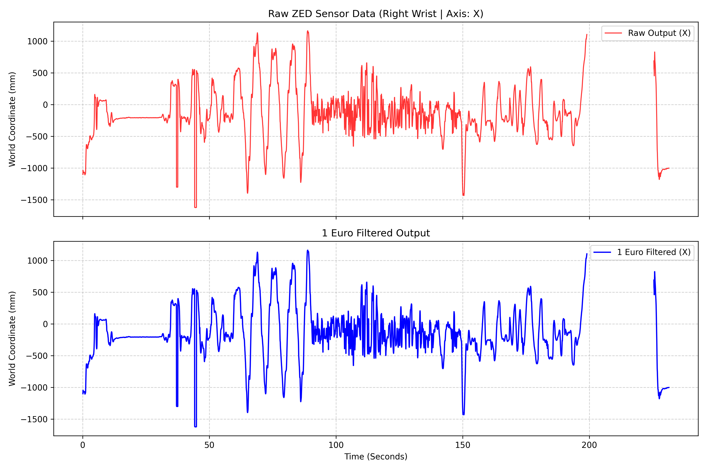

> Top (red): the raw ZED coordinate of the selected joint and axis over time. Bottom (blue): the same signal after the 1 Euro Filter, on the same scale. Read it in two places: where the joint is at rest, the filtered curve should be free of the fine jitter of the raw one; where the joint moves fast, the filtered curve should follow the raw one without a visible delay. Too much remaining jitter calls for a lower `min_cutoff`; a visible delay calls for a higher `beta`.

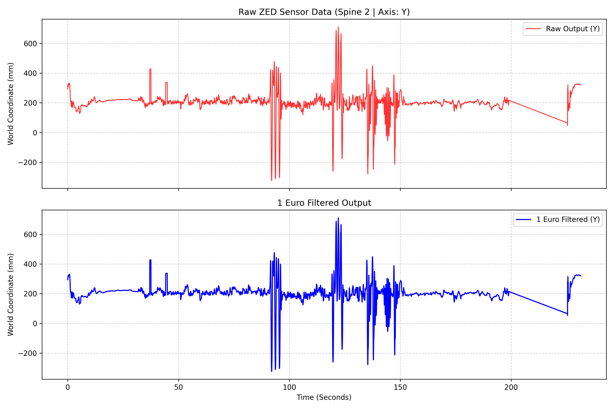

> The same comparison for the vertical axis of `spine_2`. The spine moves far less than a wrist, so a larger share of its raw signal is sensor noise, which makes the effect of the filter at rest easier to see.

**LMA expansiveness** — `kinematics/lma_expansiveness.png`

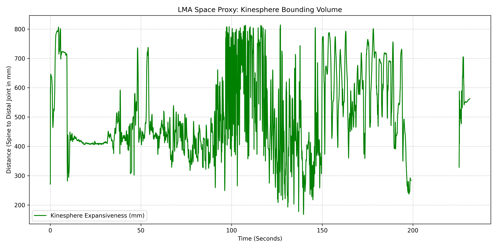

> The largest distance from `spine_2` to either wrist, over time, in millimetres: a proxy for how far the performer reaches into the space around the body (the *kinesphere* in Laban Movement Analysis). Peaks are wide reaching gestures; valleys are arms held close to the body. It is computed from the raw wrist positions to keep the full range of the gesture.

The 1 Euro Filter parameters validated here are the same parameters applied at runtime inside the Unreal Engine C++ component that denoises the live ZED skeleton.

---

## 🕺 Phase 5: Embodied Interaction — Kinematic AR

Phase 5 extends the compositing pipeline into a live action-perception coupling system. The performer's movement qualities, derived from the filtered 38-joint skeletal stream, drive the behaviour of foreground CG elements rendered in Unreal Engine 5. The system is grounded in Laban Movement Analysis (LMA) and computes four continuous descriptors from the live ZED body tracking data at 30 Hz. It is implemented in the runtime repository; this section summarises it.

The Embodied Interaction layer operates in two switchable modes with no level reload required:

- **Compositing Mode** — CG elements behave as depth-occluded compositing objects only. No interaction logic is active.
- **Interactive Mode** — The full EI layer activates. CG elements respond to the qualitative character of the performer's movement in real time.

### 5.1 The Four LMA Descriptors

| Descriptor | LMA Factor | Computation | Output Target |
|---|---|---|---|
| **Effort** | Time: Sudden ↔ Sustained | Weighted RMS velocity of key limb joints | Niagara: particle emission rate and velocity |
| **Expansiveness** | Space: Expanded ↔ Contracted | Maximum wrist-to-spine_2 distance | MPC: WPO surface deformation frequency + RadialForce radius |
| **Weight** | Weight: Strong ↔ Light | Acceleration magnitude across key joints | MPC: WPO surface bend amplitude |
| **Flow** | Flow: Free ↔ Bound | Rolling standard deviation of velocity delta | Niagara: attractor strength + MPC: surface noise scale |

The force field distributes along the direction vector from `spine_2` to the furthest wrist, not omnidirectionally: a forward arm thrust pushes the CG grid forward; a lateral sweep pushes it laterally. The magnitude is governed by the quality descriptors.

### 5.2 The Eight LMA Action Drives

The four descriptors combine to produce the eight canonical LMA Action Drives as continuous regions rather than discrete classes. The system positions the movement continuously within the four-dimensional Effort space.

| Action Drive | Time | Weight | Space | Flow | CG Grid Response |
|---|---|---|---|---|---|
| **Punch / Thrust** | Sudden | Strong | Contracted | Bound | Forceful tight implosion, spike rebound |
| **Slash** | Sudden | Strong | Expanded | Free | Maximum scatter, turbulent surface, dense particles |
| **Wring** | Sustained | Strong | Expanded | Bound | Slow outward stretch with weight, wide arc bends |
| **Press** | Sustained | Strong | Contracted | Bound | Deliberate inward compression, deep smooth bends |
| **Flick** | Sudden | Light | Expanded | Free | Light scatter, brief surface flutter, fast sparse particles |
| **Dab** | Sudden | Light | Contracted | Bound | Small precise burst, minimal deformation |
| **Float** | Sustained | Light | Expanded | Free | Slow outward drift, gentle undulation, sparse particles |
| **Glide** | Sustained | Light | Contracted | Bound | Tight stable formation, smooth surfaces, calm field |

### 5.3 CG Element Design — Particle Grid

The demonstration scenario places the performer at the centre of a three-dimensional grid of physics-simulated cubes in the LED volume, anchored to the performer's pelvis. The grid demonstrates all three technical pillars of the system at once:

- **Compositing and occlusion:** cubes in front of the performer cover the body; cubes behind are hidden by it. A moving camera continuously renegotiates these depth relationships.
- **Embodied interaction:** cube surfaces deform and scatter in response to movement quality.
- **Perceptual legibility:** gaps between cubes keep the performer visible, so compositing and interaction are readable in a single frame.

### 5.4 Runtime Architecture

**`UKinematicDescriptorComponent`** reads the live ZED LiveLink BODY_38 subject every tick, applies the 1 Euro Filter, computes the four LMA descriptors, runs the adaptive output curve (dead zone + saturation sigmoid), and writes the results to `MPC_KinematicAR` and the Niagara component.

**`UProximityDispatchComponent`** reads the pelvis position every tick and writes a normalised `PerformerProximity` value to each registered AR mesh, driving a contact deformation that is active in both modes.

| `MPC_KinematicAR` parameter | Written by | Controls |
|---|---|---|
| `ExpansivenessLevel` | `UKinematicDescriptorComponent` | WPO deformation frequency, RadialForce radius |
| `WeightLevel` | `UKinematicDescriptorComponent` | WPO surface bend amplitude |
| `FlowLevel` | `UKinematicDescriptorComponent` | WPO surface noise scale |
| `SystemMode` | `UProximityDispatchComponent::SetSystemMode()` | Gates WPO channels 2 and 3 in all AR materials |

| `NS_KinematicAR` user parameter | Controls |
|---|---|
| `User.EffortLevel` | Particle emission rate and initial velocity |
| `User.FlowLevel` | Mutual attractor strength between grid cubes |

### 5.5 Smoothing Models as Artistic Parameters

On top of the 1 Euro Filter, the output descriptors pass through an adaptive interpolation stage. Three mapping models are selectable at runtime via the `EAdaptiveModel` enum. The choice defines the expressive relationship between the performer and the AR environment:

| Model | LMA Quality | Dance Tradition |
|---|---|---|
| **Linear** | Sustained + Bound | Classical Ballet, Cecchetti, RAD, Neoclassical |
| **Sigmoid** | Transitional + Free | Contemporary, Limón, Contact Improvisation, Cunningham |
| **Piecewise** | Sudden + Strong, Bound between states | Hip-Hop, Flamenco, Butoh, Breaking |

---

## 🎭 Phase 6: Occlusion Refinement

### What occlusion is, and what can go wrong

For every pixel of the Sony image, the composite must decide whether the real scene or the CG object is closer to the camera. The real distance comes from the ZED depth map; the CG distance comes from Unreal Engine. When the real surface is closer, the camera image is shown (the performer hides the CG); otherwise the CG is shown.

Errors in the ZED depth map appear in two ways:

- **Show-through:** CG visible on the performer, where the ZED's depth wrongly says "far".
- **Halos and false cut-outs:** holes cut into CG around the performer, where unreliable pixels wrongly say "near". These concentrate along silhouettes, where the stereo matching cannot tell foreground from background.

### The live pipeline (summary)

| Stage | Where it runs | What it does |
|---|---|---|
| Confidence gating | Jetson, `zed_ndi_streamer.py` | Removes depth pixels whose ZED confidence value is above the threshold (50); they are sent as an explicit "invalid" code |
| Depth transport | Jetson → NDI → Unreal Engine | Depth encoded as 8-bit codes (0–235 = 0.5–6.0 m, 255 = invalid) |
| Reprojection | Unreal Engine, `M_ZED_DepthReproject` | Moves the ZED depth into the Sony's viewpoint with the Phase 3 calibration, by walking along each Sony pixel's line of sight through the ZED depth map. Invalid pixels are skipped, and areas hidden from the ZED take the background depth behind them |
| Median filter | Unreal Engine, own pass | 5 × 5 median of the reprojected depth: removes isolated speckles without moving edges |
| Occlusion matte | Unreal Engine, `M_MatteEMA` | Depth comparison with a small bias towards CG, 1-pixel erosion of the real-world cut-out, and a temporal average |
| Edge refinement | Unreal Engine, composite material | Feathering and image-guided snapping of the matte edge to edges in the Sony image |

Two findings from bringing this pipeline up on the rig shaped it:

- **The NDI depth texture is treated as a colour image.** Unreal Engine marks NDI video textures as sRGB and converts every value with the sRGB-to-linear curve when it reads them. For depth codes this compresses all distances towards the camera (2.0 m was read as about 0.8 m), so the reprojection over-corrected the parallax between the two cameras. The reprojection shader now converts the values back. With the correct depth, the depth silhouette lands on the performer in the Sony image, and most edge artefacts disappear.
- **A hole-fill stage was removed.** Filling invalid pixels with the nearest valid depth was useful while the reprojection streaked at invalid pixels. Once the reprojection skipped invalid pixels and decoded depth correctly, the fill only enlarged the performer's cut-out at every hole and made the edges flicker.

### 6.1 The offline service: confidence-gating validation

```bash
docker compose run --rm occlusion ./run_occlusion.sh <dataset name> [options]
```

The ZED SDK gives every depth pixel a **confidence value** from 1 (reliable) to 100 (unreliable). The gate removes every pixel above a threshold. This service measures, on a recorded dataset, **how many pixels the gate removes, where, and how that changes with scene motion**, before the threshold is used live. It reads the synced `zed_depth` and `zed_confidence` frames, so it runs after Phases 1 and 2.

| Option | Default | Meaning |
|---|---|---|
| `--confidence-threshold` | 50 | Pixels with a confidence value above this are removed (lower value = more reliable pixel) |
| `--trim-start` | 1000 | Frames excluded from the start of the dataset |
| `--trim-end` | 1000 | Frames excluded from the end of the dataset |
| `--sample-count` | 12 | Number of sample frames, chosen to span slow to fast scene motion |
| `--frames` | none | Extra frame indices to include as samples |

The first and last frames of a recording show the performer walking to and from the cameras, so they are excluded from every statistic, plot and sample.

**What it computes**

- **Removal rate** per frame: pixels removed by the gate ÷ pixels that have a depth value. Pixels without depth are left out, because the gate cannot remove what is already missing.
- **Scene motion** per frame: the average depth change, in millimetres, against the frame 5 frames earlier. It shows whether removal follows movement, and it chooses sample frames from slow to fast movement.
- **Removal frequency** per pixel: in how many of the analysed frames each pixel was removed. It separates persistent removals (static scene edges) from removals that move with the performer.

### Result — dataset_01 (threshold 50, frames 400 to 6049)

| Statistic | Value |
|---|---|
| Mean share of valid pixels removed | 0.64 % |
| Median | 0.54 % |
| Maximum | 1.93 % (frame 1111) |
| Empty-room baseline (static furniture edges) | about 0.42 % |

| Frames | Mean removed | Note |
|---|---|---|
| 400 to 949 | 0.54 % | |
| 950 to 1881 | 0.99 % | Performer moves closer to and further from the camera |
| 1882 to 2300 | 0.49 % | |
| 2300 to 3000 | 0.65 % | |
| 3000 to 4700 | 0.59 % | |
| 4700 to 6049 | 0.52 % | |

The removed pixels concentrate on silhouette edges, in the gaps between the arms and the torso, and in a few regions on the body that repeat at the same locations over time. On the live rig, the same threshold raises the share of pixels without depth from about 6 % (SDK default threshold 95) to 10–12 %, and removes the false "near" pixels that cut holes into the CG.

### Plots

**Removal rate and scene motion** — `occlusion/confidence_gating_rejection_rate.png`

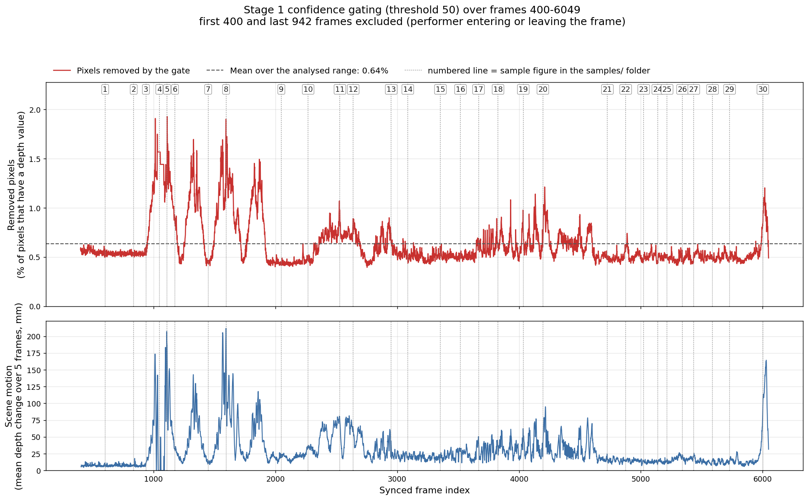

> Top: the share of depth pixels the gate removed in each frame; the dashed line is the mean. Bottom: how much the scene moved in each frame. The numbered dotted lines mark the frames shown as sample figures. When the removal rate rises together with the motion, the gate is reacting to the performer (moving silhouettes, motion blur) rather than to the static room.

**Where pixels are removed** — `occlusion/rejection_frequency_map.png`

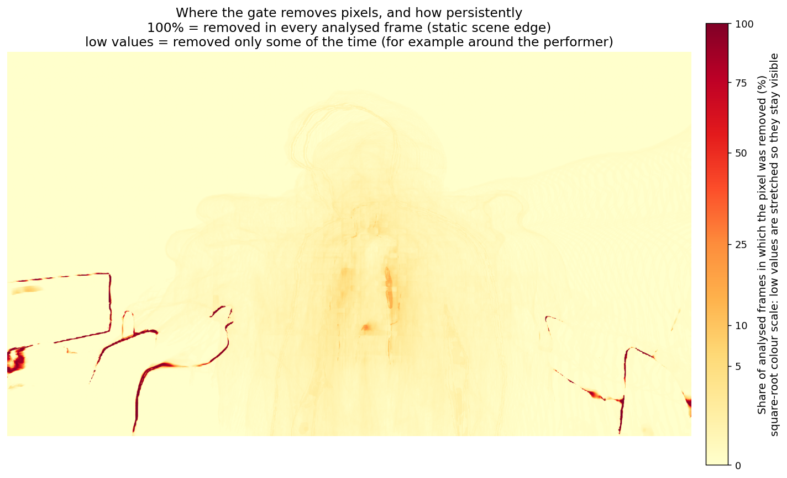

> Every pixel coloured by the share of analysed frames in which it was removed. Dark red lines (close to 100 %) are static edges of the room and furniture, removed in nearly every frame. Faint, spread areas are removed only some of the time, where the performer moved. The colour scale is stretched (square root) so that rare removals stay visible.

**Sample frame** — `occlusion/samples/sample_NN_frame_<index>.png`

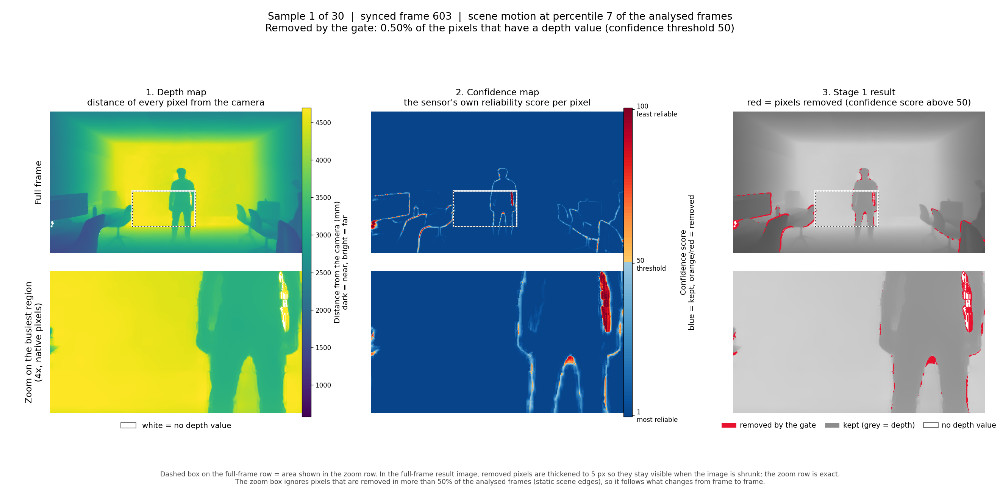

> One analysed frame in three panels. 1: the depth map (distance of every pixel). 2: the confidence map (the sensor's own reliability score). 3: the result of the gate, with removed pixels in red. The bottom row zooms 4× into the region where the most pixels changed in this frame, ignoring static edges. The title gives the share of pixels removed in this frame.

**Output: `occlusion_stage1_report.json`**

```json
{
  "meta": {
    "dataset": "dataset_01",
    "stage": "confidence_gating",
    "confidence_threshold": 50,
    "analysed_range": { "first_frame": 400, "last_frame": 6049, "trim_start": 400, "trim_end": 942 }
  },
  "summary": {
    "mean_pct_rejected_of_previously_valid_pixels": 0.636,
    "median_pct_rejected_of_previously_valid_pixels": 0.543,
    "max_pct_rejected_of_previously_valid_pixels": 1.929,
    "frame_with_max_rejection": 1111
  },
  "samples": [
    { "sample": 1, "frame_idx": "...", "reason": "...", "file": "sample_01_frame_<index>.png" }
  ],
  "per_frame": [
    {
      "frame_idx": "...",
      "n_valid_depth_pixels": "...",
      "n_removed_pixels": "...",
      "pct_rejected_of_previously_valid_pixels": "...",
      "motion_energy_mm": "..."
    }
  ]
}
```

> The `summary` values are those of the dataset_01 run; the `samples` and `per_frame` entries show the field layout only. `motion_energy_mm` is `null` for the first frames of the range, where there is no earlier frame to compare against.

### 6.2 Limits

- The removal rate is a **proxy**: it shows that the gate targets the right pixels, not how often the live composite is actually wrong, which needs the live system.
- The edge refinement stages (median, matte, feathering, guided filtering) run only in Unreal Engine. Offline versions would need frame-accurate depth for every Sony frame, so they are tuned on the rig.
- **Disocclusion:** next to every foreground object there is a strip the Sony sees and the ZED cannot (the ZED sits about 13 cm from the Sony). The reprojection fills it with the background depth, which is correct for the background but cannot recover detail inside the strip.

---

## 🔗 Related Repositories

| Repository | Role |
|---|---|
| [`VP_AR_full_System`](https://github.com/Muhannad7794/VP_AR_full_System) | This repository. Offline pipeline: extraction, temporal and spatial alignment, kinematics, occlusion validation. |
| [`VP_AR_full_System_runtime`](https://github.com/Muhannad7794/VP_AR_full_System_runtime) | UE5 runtime: camera tracking, compositing, occlusion, EI descriptor components, Niagara, mode switching. |
| [`vp_baseFree_tracking`](https://github.com/Muhannad7794/vp_baseFree_tracking) | Adaptive smoothing analysis pipeline for camera tracking. |

---

## Output Reference

| Path | Contents |
|---|---|
| **Extraction** | |
| `data/extracted/<dataset>/sony_rgb/` | Sony frames |
| `data/extracted/<dataset>/zed_rgb/` | Rectified ZED left images |
| `data/extracted/<dataset>/zed_depth/` | 16-bit ZED depth maps, millimetres, 0 = no depth |
| `data/extracted/<dataset>/zed_confidence/` | 8-bit ZED confidence maps, 1 (reliable) to 100 |
| `data/extracted/<dataset>/zed_frames.csv`, `sony_frames.csv` | Per-frame timestamps, luma and motion |
| `data/extracted/<dataset>/extraction_info.json` | Extraction summary and recorder-log comparison |
| `data/json_output/<dataset>/zed_intrinsics_extraction.json` | Rectified ZED intrinsics of the extraction session |
| **Temporal alignment** | |
| `data/json_output/<dataset>/frame_mapping.json` | Sony frame → ZED frame, active window |
| `data/json_output/<dataset>/frame_mapping_full.json` | The same for the whole overlap |
| `data/json_output/<dataset>/frame_mapping_detail.csv` | Times, matched frame, residual and flags per Sony frame |
| `data/json_output/<dataset>/sync_report.json` | Offsets, cover events, drift check, decisions |
| `data/json_output/<dataset>/smoothed_frame_mapping.json` | Median-filtered mapping (the one compiled) |
| `data/txt_output/<dataset>/mapping_comparison.txt` | Frames changed by the smoothing |
| `data/plots/<dataset>/sync/` | `sync_luma.png`, `sync_correlation.png`, `sync_drift.png`, `sync_residuals.png` |
| `data/plots/<dataset>/drift_comparison.jpg` | Frame offset over the recording, raw and smoothed |
| `data/synced/<dataset>/` | `sony_rgb/`, `zed_rgb/`, `zed_depth/`, `zed_confidence/`, `synced_index.csv` |
| **Spatial alignment** | |
| `data/json_output/<dataset>/zed_intrinsics.json` | ZED rectified intrinsics used by the calibration |
| `data/json_output/<dataset>/detections.json.gz` | Board detections, usability and stillness for every frame |
| `data/json_output/<dataset>/detection_summary.json` | Detection counts |
| `data/json_output/<dataset>/sony_intrinsics.json` | Sony lens models, held-out errors, selected model |
| `data/json_output/<dataset>/pair_selection.json` | Calibration and held-out pairs with pose features |
| `data/json_output/<dataset>/spatial_calibration.json` | Extrinsics, uncertainty, Unreal Engine values, board used |
| `data/json_output/<dataset>/validation_report.json` | Held-out, distance-resolved and end-to-end errors, checks, grade |
| `data/picked_for_alignment/<dataset>/`, `data/picked_for_validation/<dataset>/` | Copies of the selected calibration and held-out frames |
| `data/plots/<dataset>/spatial/` | `detection_timeline.png`, `sony_intrinsics_models.png`, `sony_intrinsics_coverage.png`, `sony_runtime_displacement.png`, `pair_selection_features.png`, `reprojection_error_analysis.png`, `error_vs_distance.png`, `bias_vs_inverse_distance.png`, `depth_scale_check.png`, `error_across_sony_frame.png`, `corner_coverage_sony_rgb.png`, `corner_coverage_zed_rgb.png` |
| **Kinematics** | |
| `data/extracted/<dataset>/kinematics/raw_skeleton_data.csv` | Raw 38-joint 3D coordinates (mm) per tracked frame |
| `data/plots/<dataset>/kinematics/` | `1Euro_noise_reduction_{joint}_{axis}.png`, `lma_expansiveness.png` |
| **Occlusion refinement** | |
| `data/json_output/<dataset>/occlusion_stage1_report.json` | Gating statistics, per-frame rates, selected samples |
| `data/plots/<dataset>/occlusion/` | `confidence_gating_rejection_rate.png`, `rejection_frequency_map.png`, `samples/` |

### README figures

`data/` is not tracked by Git, so the figures shown above are copies in `docs/assets/`. After a new run, refresh them with:

```bash
./collect_readme_assets.sh [spatial and temporal dataset] [kinematics dataset] [occlusion dataset]
# default: ./collect_readme_assets.sh dataset_05 dataset_01 dataset_01
```

---

## Directory Structure

See [`directory_structure.txt`](directory_structure.txt) for the annotated tree. In short:

```
VP_AR_full_System/
├── data/                     # Not tracked: raw recordings and every output
├── docs/                     # Project page and the README figures (docs/assets/)
├── temporal_alignment/       # Phase 2 (and check_svo.py)
├── spatial_alignment/        # Phase 3
├── skeleton_filtering/       # Phase 4
├── occlusion_refinement/     # Phase 6
├── extract_frames.py         # Phase 1
├── run_extract.sh  run_temporal.sh  run_spatial.sh  run_filtering.sh  run_occlusion.sh
├── collect_readme_assets.sh
├── docker-compose.yml  Dockerfile  requirements.txt
└── README.md  directory_structure.txt
```